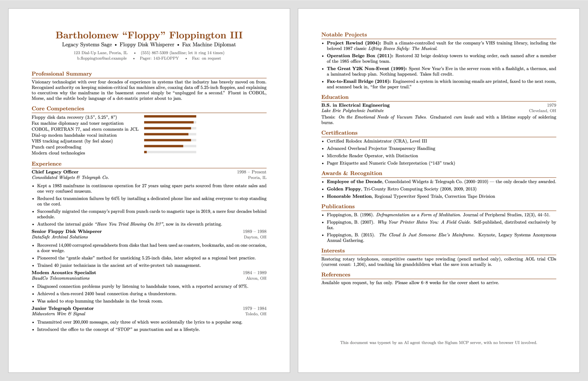

# Siglum MCP server

An [MCP](https://modelcontextprotocol.io) server that compiles LaTeX to PDF with
the Siglum engine. Agents call a tool and get a PDF on disk, without driving a
browser UI.



## Requirements

- Node.js 20.6 or later
- Google Chrome, Microsoft Edge, or Playwright's Chromium (`npx playwright install chromium`)
- Internet access for the first compile, and for packages that aren't cached yet

## Setup

The server isn't published to npm yet, so run it from a checkout:

```sh
git clone https://github.com/SiglumProject/siglum.git
cd siglum/mcp
npm install
```

**Claude Code**

```sh
claude mcp add siglum -- node /absolute/path/to/siglum/mcp/src/server.mjs
```

`claude mcp list` should show `siglum: ... ✔ Connected`.

**Claude Desktop and other clients:** add this to the client's MCP config. For
Claude Desktop on macOS that's `~/Library/Application Support/Claude/claude_desktop_config.json`.
The desktop app doesn't use your shell's `PATH`, so if `node` isn't found, give its
full path (`which node`).

```json
{
  "mcpServers": {
    "siglum": { "command": "node", "args": ["/absolute/path/to/siglum/mcp/src/server.mjs"] }
  }
}
```

## Tools

### `compile_latex`

Pass either `path` or `source`.

| Argument | |
| --- | --- |
| `path` | Main `.tex` file. Everything in its directory (or `projectRoot`) is available to TeX: `\input` files, images, `.bib`, local `.sty`/`.cls`. |
| `source` | Inline LaTeX. Use `files` to add extra text files, e.g. `{"refs.bib": "..."}`. |
| `engine` | `auto` (default), `pdflatex`, or `xelatex`. |
| `outputPath` | PDF destination. Defaults to `<main>.pdf` next to `path`, or a temp file for `source`. |
| `logLines` | Trailing TeX log lines in the reply (default 40). The full log is always written next to the PDF. |

On success:

```text
Compiled successfully in 829 ms → /work/resume/resume.pdf (187690 bytes).
Full log: /work/resume/resume.log
```

On failure, `isError` is set, no PDF is written, and the reply starts with the TeX error:

```text
Compilation failed: /document.tex:3: Undefined control sequence.
```

`structuredContent` carries the same data: `success`, `error`, `pdfPath`, `pdfBytes`,
`logPath`, `elapsedMs`, and `skippedFiles`.

Not sent to TeX: hidden directories, `node_modules`, build output (`.aux`, `.log`,
the previous PDF, …), and anything past 2,000 files, 50 MB per file, or 200 MB in total.

### `clear_cache`

Deletes cached packages and compiled PDFs.

## How it works

The engine needs Web Workers, OPFS and IndexedDB, so the server runs it unchanged
in a headless browser. A local server on `127.0.0.1:47787` serves the engine to that
browser, and the runtime is fetched from `packages.siglum.org`.

The browser profile in `~/.cache/siglum-mcp/profile` keeps everything it downloads.
The first compile fetches the runtime; after that, compiles take about a second.
Compiles run one at a time.

## Limitations

- XeLaTeX currently fails against the hosted runtime with
  `internal error; cannot read font names`. This is an engine/runtime issue (the
  published `@siglum/engine` 0.2.2 fails the same way). Use pdfLaTeX for now.
- Biber isn't available. Use `biblatex` with `backend=bibtex`, or BibTeX.
- Only one server process can use the persistent cache. A second one, for example from
  another client running at the same time, works but starts with an empty cache.

## Troubleshooting

| Message | Fix |
| --- | --- |
| `No Chromium-based browser found` | Install Chrome, or run `npx playwright install chromium` in `mcp/`. |
| `Could not fetch runtime metadata from …` | No network or a wrong `SIGLUM_RUNTIME_SERVICE_URL`. |
| Stale or broken package | Call `clear_cache`, or delete `~/.cache/siglum-mcp`. |

Set `SIGLUM_MCP_DEBUG=1` to forward engine logs to the server's stderr.

## Configuration

| Variable | |
| --- | --- |
| `SIGLUM_RUNTIME_SERVICE_URL` | Runtime discovery service (default `https://packages.siglum.org`). |
| `SIGLUM_RUNTIME_CONFIG_URL` | Full compiler config URL, e.g. `http://localhost:8787/runtime-config.json` from `bun run dev`, to use a locally staged runtime. |
| `SIGLUM_ENGINE_SRC` | Engine `src/` to serve. Default: this checkout, otherwise the installed `@siglum/engine`. |
| `SIGLUM_MCP_CACHE_DIR` | Cache location (default `~/.cache/siglum-mcp`). |
| `SIGLUM_MCP_PORT` | Local port (default 47787). Browser storage is per origin, so changing it starts a fresh cache. |
| `SIGLUM_MCP_BROWSER_CHANNEL` | Use a specific installed browser: `chrome` or `msedge`. |
| `SIGLUM_MCP_WARM` | Start the engine when the server starts instead of on the first compile. |

## CLI

```sh
node src/cli.mjs paper.tex -o paper.pdf
```

Prints the PDF path, or the TeX error and log path with exit code 1.

## Tests

```sh
npm test          # project loading, no browser
npm run smoke     # spawns the server over stdio and compiles through MCP
```
